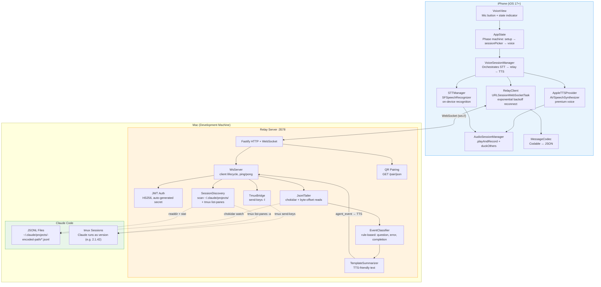
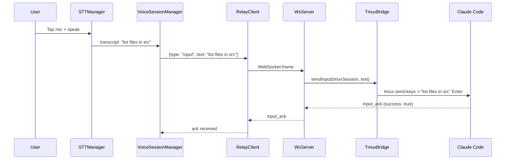
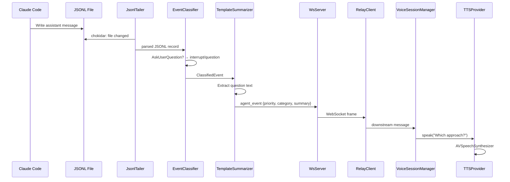
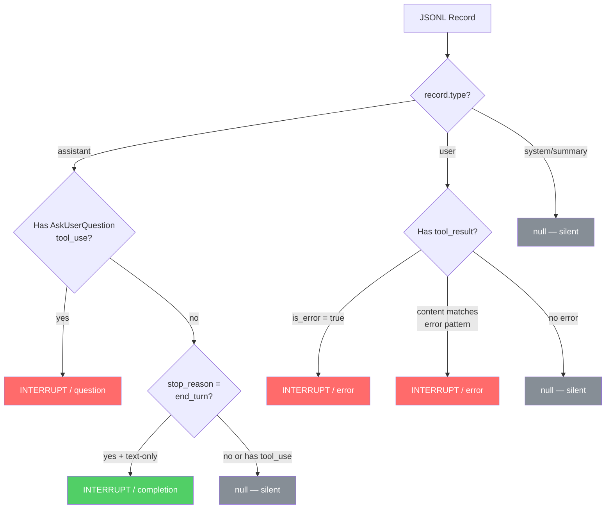
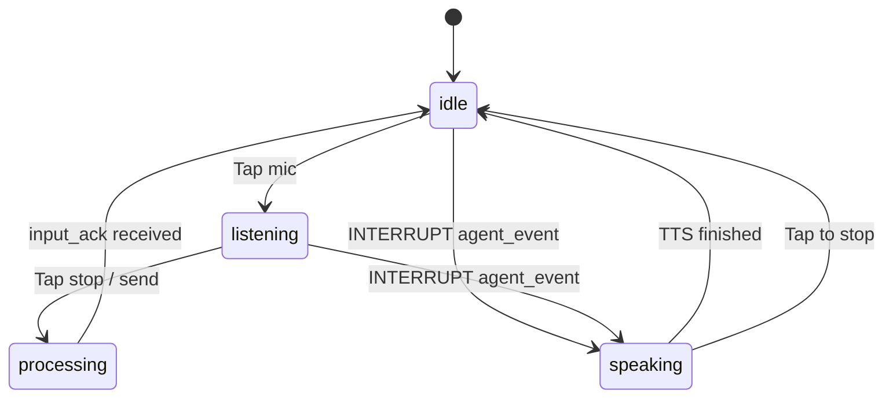

# Vibe Code v2 Architecture

## Overview

Vibe Code is a voice-first mobile companion for Claude Code. A relay server on the Mac bridges an iPhone app to existing Claude Code sessions, enabling hands-free voice interaction while walking, commuting, or away from the desk.

## System Diagram

## Data Flow

### Voice Command (Phone → Claude Code)

### Event Notification (Claude Code → Phone)

## Core Components

### Relay Server (`relay-server/`)

| Component | File | Purpose |
|-----------|------|---------|
| Entry point | `src/index.ts` | Fastify + WebSocket wiring, message routing |
| Config | `src/config.ts` | Port, paths, timeouts from env |
| Protocol | `src/protocol/messages.ts` | Zod schemas for all WebSocket messages |
| Auth | `src/server/auth.ts` | JWT HS256, secret auto-generation |
| WS Server | `src/server/ws-server.ts` | Client lifecycle, auth flow, ping/pong |
| QR Pairing | `src/server/qr-pairing.ts` | GET /pair/json, QR terminal output |
| Discovery | `src/sessions/session-discovery.ts` | Scan JSONL dirs + tmux correlation |
| JSONL Tailer | `src/sessions/jsonl-tailer.ts` | chokidar watch, byte-offset reads |
| tmux Bridge | `src/sessions/tmux-bridge.ts` | send-keys, capture-pane |
| Classifier | `src/pipeline/event-classifier.ts` | Rule-based event → priority mapping |
| Summarizer | `src/pipeline/template-summarizer.ts` | Human/TTS-friendly text extraction |

### iOS App (`ios-app/`)

| Component | File | Purpose |
|-----------|------|---------|
| App State | `Models/AppState.swift` | Phase machine: setup → sessionPicker → voice |
| Relay Client | `Networking/RelayClient.swift` | URLSessionWebSocketTask + auto-reconnect |
| Message Codec | `Networking/MessageCodec.swift` | Codable enums matching Zod schemas |
| STT | `Audio/STTManager.swift` | SFSpeechRecognizer, on-device |
| TTS | `Audio/AppleTTSProvider.swift` | AVSpeechSynthesizer, async/await |
| Audio Session | `Audio/AudioSessionManager.swift` | .playAndRecord, duck others |
| Voice Manager | `Managers/VoiceSessionManager.swift` | STT → relay → TTS orchestration |
| Voice View | `Views/VoiceView.swift` | Mic button, state indicator, event log |

## WebSocket Protocol

### Phone → Relay (Upstream)

| Type | Fields | Purpose |
|------|--------|---------|
| `auth` | `token` | JWT from QR scan |
| `input` | `sessionId`, `text` | Transcribed speech → tmux |
| `session_list_request` | — | Request available sessions |
| `attach` | `sessionId` | Start tailing a session's JSONL |
| `detach` | — | Stop tailing |
| `pong` | — | Keepalive response |

### Relay → Phone (Downstream)

| Type | Fields | Purpose |
|------|--------|---------|
| `auth_result` | `success`, `error?` | Auth response |
| `session_list` | `sessions[]` | Available Claude Code sessions |
| `agent_event` | `sessionId`, `priority`, `category`, `summary`, `timestamp` | Event to speak/display |
| `input_ack` | `sessionId`, `success`, `error?` | Input injection result |
| `session_state` | `sessionId`, `state` | Session lifecycle changes |
| `ping` | — | Keepalive |

## Event Classification

### Error Patterns

The classifier detects errors by checking the first line of tool result content for:
- `exit code N` (where N ≠ 0)
- `error:`, `fatal:`, `panic:`, `traceback`, `exception:`

## Security

| Layer | Mechanism |
|-------|-----------|
| Authentication | JWT HS256, auto-generated 64-byte secret at `~/.vibe-code/relay-secret.key` |
| Token lifecycle | No expiry — revoke by regenerating the secret |
| Transport | WebSocket over local network (LAN or Tailscale) |
| Auth timeout | 10s to authenticate after connecting, else disconnected |
| Credential storage | iOS Keychain for relay token, UserDefaults for relay URL |

## Session Discovery

1. Scan `~/.claude/projects/` for subdirectories
2. Decode encoded dir names: `-Users-username-Code-project` → `/Users/username/Code/project`
3. Find most recent `.jsonl` file per project directory
4. Correlate with `tmux list-panes -a` — Claude Code shows as version number (e.g. `2.1.42`) in `pane_current_command`
5. Return sorted: active sessions first, then by last activity descending
6. Cache results for 5 seconds

## Voice State Machine

## Tech Stack

### Relay Server
- **Runtime**: Node.js 22, ESM
- **HTTP**: Fastify v5
- **WebSocket**: @fastify/websocket (wraps ws)
- **Validation**: Zod 3.x with discriminatedUnion
- **Auth**: jsonwebtoken (HS256)
- **File watching**: chokidar
- **Dev**: TypeScript 5.x strict, tsx for hot-reload, vitest

### iOS App
- **UI**: SwiftUI (iOS 17+)
- **WebSocket**: URLSessionWebSocketTask (built-in)
- **Speech**: SFSpeechRecognizer (on-device)
- **TTS**: AVSpeechSynthesizer (premium voice)
- **Audio**: AVAudioSession (.playAndRecord)
- **Storage**: Keychain + UserDefaults
- **Dependencies**: Zero external packages
